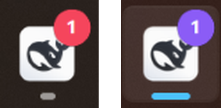

# dsh-badge

English | [中文](README.md)

The same red corner badge ChatGPT puts on its tab, for DeepSeek Harness: the unread count on the tab icon and the Windows taskbar button, plus a chime when a turn finishes.

<p align="center">
  
</p>

## What it does

- A badge on the tab icon showing the unread turn count (`99+` past 99)
- The title becomes `(3) DeepSeek Harness`
- On Windows the taskbar button gets the same numeric badge, cleared when the window returns to the foreground
- A chime when a turn finishes, three tones to choose from, with an optional lower alert for failed turns
- The count clears about 1.2 seconds after the tab becomes visible again

The tone is synthesised with Web Audio, so the plugin ships no audio files. The badge is drawn on a canvas and swapped into `<link rel="icon">`, keeping the site's own icon underneath.

## Install

### From the plugin market

Search for `dsh-badge` and install. Restart or wait for the hot mount as the market suggests.

### From npm

```bash
dsh plugin --profile desktop add dsh-badge
```

`dsh plugin add` only runs pnpm and does not touch `dsh.profile.bundles`. Add `dsh-badge` to that array in the profile's `package.json` afterwards, or the plugin will not load.

### Manually, from a local checkout

Put this repository anywhere, then add two things to the profile's `package.json`:

```jsonc
{
  "dependencies": {
    "dsh-badge": "file:../dsh-badge"
  },
  "dsh": {
    "profile": {
      "bundles": [
        // ...existing entries
        "dsh-badge"
      ]
    }
  }
}
```

Run `pnpm install` in the profile directory. A missing line in `bundles` means the plugin never loads.

## Configuration

Override the defaults in the profile's `cordis.patch.yml`. Both `id` and `name` are required, and `id` is the `badge` used by the insert entry:

```yaml
- id: badge
  name: dsh-badge
  config:
    volume: 0.6
    soundPreset: beep
    minTurnDurationMs: 5000
```

| Option | Default | Meaning |
| --- | --- | --- |
| `enabled` | `true` | Master switch |
| `badge` | `true` | Draw the icon badge |
| `titlePrefix` | `true` | Prefix the title with `(N) ` |
| `sound` | `true` | Play the chime |
| `soundPreset` | `chime` | `chime` two-note bell, `beep` square blip, `rise` three ascending notes |
| `soundUrl` | `''` | Custom audio URL, replaces the built-in tone |
| `volume` | `0.5` | Volume from 0 to 1, applied on a power curve rather than linearly |
| `minTurnDurationMs` | `3000` | Turns shorter than this stay quiet and raise no badge |
| `clearOnFocus` | `true` | Clear the count when the tab becomes visible again |
| `badgeColor` | `#f5455c` | Hex colour of the badge disc |
| `badgePosition` | `br` | `br` bottom-right, `tr` top-right |
| `errorSound` | `false` | Lower alert when a turn fails |
| `desktopBadge` | `true` | Windows only: draw the count on the taskbar button |
| `desktopBadgeWindow` | `DeepSeek Harness` | Process name whose window carries the taskbar button |
| `desktopBadgeClearOnFocus` | `true` | Clear the taskbar badge when the window returns to the foreground |
| `debugLog` | `''` | A file path; the plugin appends one line per load, which tells "never mounted" apart from "browser did not draw it" |

## Settings page

Settings → **Plugin manager** → open the `dsh-badge` bundle, and the form is on that page:

- **Colour**: six preset swatches plus a colour picker
- **Corner**: bottom-right or top-right
- **Chime**: two-note bell, square blip or three-note rise; picking one plays it, and a "Preview current tone" button repeats it
- **Volume**: a 0–100% slider
- **Minimum turn length**: a number input

Changes apply immediately and are written to the Host settings document after a short pause. There is no save button; the footer shows "Saved automatically" or "Saving…", and offers a retry when the write is rejected.

The form registers into the `plugins.bundle.config` slot under the package name `dsh-badge`. Community bundles cannot use `plugins.item`, which only lists official plugins. It registers only while the Host serves the matching settings namespace, so a deployment without this plugin shows no trace of it.

The controls are drawn by hand: the shared `SettingsValueField` renders a text input only, with no switch, select or colour picker, so the card keeps `SettingsFormModel` for staging and saving and builds the interface from native controls. Boolean options still live in the config file.

The editable fields are declared `volatile()`: the Host only serves a settings namespace for entries that have at least one. On the host such a field is a reference object with `get()`, and it is never serialised into the browser bundle, so the client reads live values from the settings scope's `getSnapshot().value` and subscribes to later changes.

## Manual checks

In the browser devtools console:

```js
__DSH_BADGE__.test(3)          // show 3 and chime once
__DSH_BADGE__.clear()          // reset the count
__DSH_BADGE__.sound()          // play the tone only
__DSH_BADGE__.config           // the configuration in effect
__DSH_BADGE__.lastChime()      // volume, tone and gain the last chime used
__DSH_BADGE__.diag             // settings form registration state
```

`demo/index.html` is a standalone page: open it directly. It loads the real `client.js` from this repository and replaces only the DSH sessions service with fake data, so the badge and the chime can be checked on their own.

With `?auto=1` the page runs a start-turn → finish-turn cycle and writes the result into `<pre id="report">`, which a headless browser can read:

```bash
chrome --headless=new --disable-gpu --virtual-time-budget=4000 \
  --dump-dom "file:///…/demo/index.html?auto=1"
```

## The taskbar badge

What it looks like in the taskbar:

<p align="center">
  
</p>

Electron's `setOverlayIcon` is out of reach here: the plugin runs in the DSH host process while the window that owns the taskbar button belongs to another one. Windows lets any process paint that overlay through `ITaskbarList3` given the HWND, so the host spawns `taskbar.ps1` and feeds it events over a pipe:

```
host index.js ──stdin: add / tick / color / quit──▶ taskbar.ps1 ──ITaskbarList3──▶ taskbar button
```

- The helper owns the count, draws the icon and watches the foreground window: `add` increments, `tick` clears when the window has just come back to the front
- The icon is drawn with `System.Drawing`: 32×32 disc, white digits, `99` past 99
- The colour follows `badgeColor`: passed in as `-BadgeColor` at startup, and the host re-reads the volatile reference every 800 ms and sends `color #rrggbb` when it changes, so a settings change needs no restart
- Subagent turns are not counted, matching the tab badge
- The helper starts with `-ParentPid` and exits once that process is gone, leaving no orphan and no stale overlay

To try it without installing anything:

```bash
npm run demo:taskbar
```

It starts the helper, pushes the count to 1, 2, 3, waits two seconds, then clears it.

## Development

```bash
npm run check   # syntax check
npm test        # unit tests (node --test, driving the real client.js against a DOM stub)
```

There is no build step: `client.js` is hand-written in the shape `window.__ModuleLoader__.load({ id, factory })` expects, so edits take effect directly.

When the repository is linked into a profile as a directory, Node resolves dependencies against the repository's real path and cannot find `@deepseek-ai/schemastery`. Create `node_modules/@deepseek-ai/schemastery` in the repository pointing at the copy in the profile (`node_modules/` is already gitignored).

On Windows, take care with encoding when editing files that contain non-ASCII text: `Get-Content` decodes BOM-less UTF-8 with the local code page and corrupts it. Use an editor for those files.

## Known limitations

- The taskbar badge is Windows only and depends on a resident PowerShell helper; on macOS and Linux only the tab badge, the title prefix and the chime remain.
- The helper finds its window by process name. If DSH is renamed or several instances run, set `desktopBadgeWindow` or turn `desktopBadge` off.
- Browsers only allow audio after the page has seen a click or a key press; the plugin unlocks the audio context on the first interaction.
- The count is a global unread-turn count, not a per-session one.

## Licence

MIT
